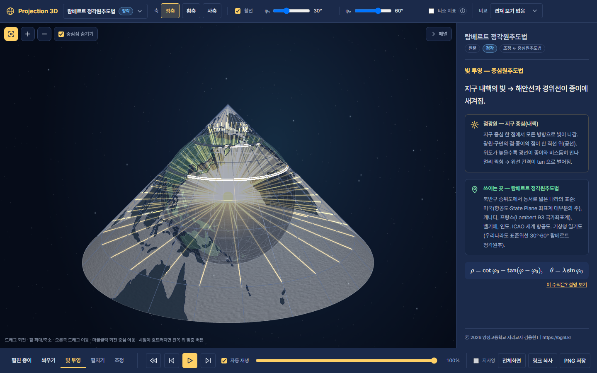

# Projection 3D (지도 투영법 3D)

지도 투영법이 어떻게 만들어지는지 3D 애니메이션으로 보여 주는 고등학교 지리 수업용 웹페이지입니다. 종이가 지구본에 씌워지고, 지구 한가운데에서 나온 빛이 해안선과 경위선을 종이에 새기고, 그 종이를 다시 펼치는 과정을 단계별로 조작합니다. 빛으로 만들 수 없는 메르카토르, 로빈슨, Equal Earth 같은 도법은 펼친 지도에서 출발해 식으로 고쳐 가는 과정을 보여 줍니다.

- 바로가기: https://proj3d.bgnl.kr



## 할 수 있는 일

- **다섯 단계**: 펼친 종이, 씌우기, 빛 투영, 펼치기, 조정. 아래 리모컨으로 재생, 일시정지, 이전과 다음, 진행 막대 끌기를 합니다. 자동 재생은 처음부터 켜져 있습니다.
- **도법 23개**: 원통(중심원통, 람베르트 정적원통, 등장방형, 메르카토르, 밀러, 횡축 메르카토르), 원추(중심원추, 정거원추, 람베르트 정각원추, 알베르스 정적원추), 방위(심사, 평사, 정사, 정거방위, 람베르트 정적방위), 의사원통(시뉴소이드, 몰바이데, 에케르트 IV, 퍼트닌시 P4′, Equal Earth, 로빈슨), 빈켈 트리펠, 구드 호몰로사인.
- **축과 표준위선**: 정축, 횡축, 사축을 바꾸고, 교과서에서 할선으로 다루는 도법은 접선과 할선을 바꾸며 표준위선을 슬라이더로 옮깁니다.
- **티소 지표**: 지도 위 원이 어떻게 늘어나고 찌그러지는지로 왜곡을 봅니다.
- **겹쳐 보기**: 다른 도법을 같은 종이에 겹쳐 비교합니다.
- **설명 패널**: 단계 설명, 광원 위치, 도법이 쓰이는 곳(예: 우리나라 일기도, 지형도 TM 좌표계), 수식과 수식 풀이, 위선 간격 그래프를 보여 줍니다.
- **회전 중심 옮기기**: 지구본이나 종이를 더블클릭(휴대폰은 두 번 탭)하면 그 자리를 중심으로 돌립니다.
- **PNG 저장**: 지금 종이에 그려진 지도를 긴 변 3000px, 투명 바탕의 흑백 그림으로 저장합니다. 채우기, 색 반전, 경위선, 티소 지표를 고릅니다.
- **수업 편의**: 전체 화면, 저사양 모드, 링크 복사(지금 도법과 단계가 주소에 담김), 휴대폰과 태블릿 화면.
- **단축키**: 스페이스(재생과 일시정지), 왼쪽과 오른쪽 화살표(이전, 다음).

## 주소로 바로 열기

링크 복사로 만든 주소는 지금 상태를 그대로 엽니다. 예:

```
https://proj3d.bgnl.kr/?p=lambertConformalConic&stage=project&t=1
```

| 값 | 뜻 |
|---|---|
| `p` | 도법 id (`mercator`, `equalEarth`, `goodeHomolosine` 등, `js/projections/registry.js` 참고) |
| `stage` | 단계 (`wrap`, `project`, `unroll`, `adjust`) |
| `step`, `t` | 조정 단계 번호, 단계 안 진행도(0~1) |
| `aspect` | `normal`, `transverse`, `oblique` |
| `phi0`, `phi1`, `phi2` | 표준위선(도) |
| `tissot=1`, `compare=<id>` | 티소 지표 켜기, 겹쳐 볼 도법 |

## 실행하기

빌드가 없는 정적 사이트입니다. 라이브러리(three.js, d3-geo, d3-geo-projection, topojson-client, KaTeX)는 CDN에서 받습니다.

```bash
npm run serve      # python -m http.server 8765 → http://localhost:8765
npm install        # 테스트에 필요한 d3 패키지 받기
npm test           # Node 에서 검증 항목 실행
```

브라우저에서 `tests/verify.html`을 열어도 같은 검증을 봅니다. 배포는 Vercel(proj3d.bgnl.kr)입니다.

## 파일 구성

```
index.html                 화면
css/style.css
js/
  main.js                  조립
  state.js                 상태와 주소 동기화
  projections/             도법 목록(registry.js), 조정 과정(derivations.js), 왜곡 계산
  geometry/                회전, 잘라내기, 종이 말기, 메시 (지리 좌표에서 3D 위치까지 한 경로)
  scene/                   지구본, 종이, 빛, 티소 원, 카메라, 회전 중심
  ui/                      리모컨, 도법 선택, 설명 패널, 쓰이는 곳, 수식 풀이, PNG 저장 창
  export/                  PNG 저장용 벡터 경로와 그리기
data/                      세계 국가와 육지 경계 (110m TopoJSON)
tests/                     검증 항목 (run.mjs, suite.js, verify.html)
PLAN.md                    설계 문서
CHANGELOG.md               바뀐 내용 기록
```

## 개발 참고

새 도법은 `js/projections/registry.js`에, 새 조정 과정은 `js/projections/derivations.js`에 항목을 더하는 방식으로만 넣습니다. 모든 점은 경위도로 보관하고 3D 위치는 하나의 합성 경로로만 계산합니다. 자세한 규칙은 [PLAN.md](PLAN.md) 6장에 있습니다.

## 자료 출처

- 해안선과 국경: Natural Earth 110m(퍼블릭 도메인), world-atlas TopoJSON 판.

## 만든 사람

양정고등학교 지리교사 김용현  
문의: bgnlkim@gmail.com
